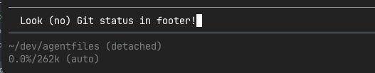
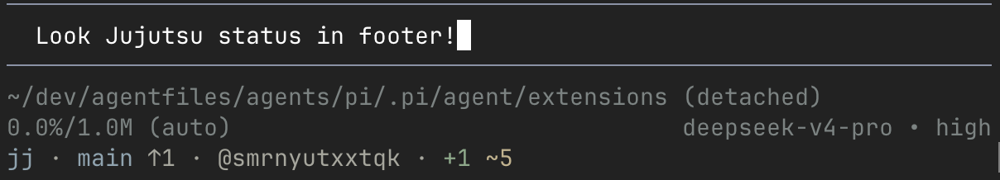

# Pi Jujutsu footer extension (`jj-footer.ts`)

Canonical maintainer documentation for the Pi extension at:

- `agents/pi/.pi/agent/extensions/jj-footer.ts`

## Purpose

When Pi runs in a Jujutsu repository, this extension adds a footer status line showing a `jj`-aware label:

- `jj` marker
- nearest bookmark name and commits ahead of that bookmark (`↑N`)
- short change ID of the working-copy commit (`@…`)
- working-copy state: explicit `clean`, or file counts (`+`, `~`, `-`, `!`)

The label is published additively with `ctx.ui.setStatus("jj-footer", …)` on Pi's shared extension status line. Pi's built-in footer (cwd/branch, token stats, context %, model, other extensions' statuses) stays fully intact — the extension never calls `setFooter`.

Example output (bookmarked, dirty working copy):

```text
jj · main ↑3 · @smrnyutxxtqk · +2 ~1 !1
```

Example output (clean working copy):

```text
jj · main · @smrnyutxxtqk · clean
```

### Before:



### After: Pi shows the active bookmark, commits ahead, the change ID, and working-copy state on the jj status line:



> **Screenshots:** both captures predate the additive status-line design (they show the old inline row-1 label) and are kept for reference pending re-capture from a live Pi session.

## Behaviour summary

The extension is additive: it publishes a status line rather than replacing Pi's footer.

1. On `session_start`, the extension clears the `jj-footer` status key and disposes any controller left over from a prior session, then searches upward from `cwd` for a `.jj/` directory.
2. If no JJ repo is found, it does nothing further — no status is published and the default footer is untouched.
3. If a JJ repo is found, it creates the jj state controller and subscribes: on every refresh, the label is re-published with `ctx.ui.setStatus("jj-footer", …)`, styled per segment with theme roles.
4. The initial state (`(loading…)` with no change ID and no counts) is published immediately on session start, so the line appears before the first refresh completes.
5. On `session_shutdown`, the controller is disposed and the status key is cleared (`ctx?.ui?.setStatus?.("jj-footer", undefined)` — the `?.` chain is deliberate: Pi may not pass a full `ctx` to `session_shutdown` in future versions, and the clear must degrade silently rather than crash).

Example labels:

- `jj · main ↑3 · @smrnyutxxtqk · +2 ~1 !1` — bookmarked, ahead, dirty
- `jj · main · @smrnyutxxtqk · clean` — bookmarked, clean
- `jj · (no bookmark) · @smrnyutxxtqk · +2 ~1` — unbookmarked, dirty
- `jj · (loading…)` — initial state before the first refresh completes
- `jj · (unavailable)` — refresh failed

## Data collection

The extension reads JJ state with commands that all pass `--ignore-working-copy` to avoid snapshotting/re-writing the working-copy commit (`@`) as a side effect of footer refresh.

Commands used:

- bookmark/ahead anchor: `jj log -r 'latest(heads(::@ & bookmarks()))' --ignore-working-copy ...`
- ahead count: `jj log -r '<anchor-commit>..@' --ignore-working-copy ...`
- change ID: `jj log -r @ --ignore-working-copy ... -T 'change_id.short() ++ "\n"'`
- file counts: `jj status --ignore-working-copy --quiet ...`

`jj` status classification:

- `A`, `?` → added (`+`)
- `M`, `R`, `T` → changed (`~`)
- `D` → deleted (`-`)
- `C` → conflicted (`!`)

Only lines matching `<CODE> <PATH>` are counted.

### Note on file-count freshness

Because `jj status` runs with `--ignore-working-copy`, footer file counts reflect the last snapshotted working-copy state rather than forcing a new snapshot during refresh.

## Refresh strategy

The extension uses both mechanisms intentionally:

- `turn_end` event: refreshes the label after agent actions
- `fs.watch(.jj/, recursive)` with debounce: catches JJ metadata changes (commits/bookmarks)

A queued refresh loop prevents overlapping refresh work and ensures the newest state is eventually shown. The controller's `notify()` listeners re-publish the label via `setStatus`; every publish re-renders the footer (Pi's `setExtensionStatus` requests a render unconditionally).

## Failure behaviour

If any refresh command fails (timeouts/command issues), the whole refresh falls back to the unavailable state rather than showing a partially stale label:

- bookmark: `(unavailable)`
- ahead: `0`
- change ID: omitted
- all file counts: `0`

The fallback state still fires `notify()`, so the status line shows `jj · (unavailable)` instead of silently keeping stale text. The extension logs debug details via `pi.logger?.debug?.(...)`.

## Status line

The extension owns the single status key `"jj-footer"`:

- `ctx.ui.setStatus("jj-footer", <label>)` publishes the current label; `setStatus("jj-footer", undefined)` clears it.
- Labels are composed as semantic segments and coloured per segment at the publish boundary with `ctx.ui.theme.fg(role, text)`:
  - `accent` — `jj` marker and bookmark name
  - `muted` — `↑N` ahead count, `@<change-id>`, `(no bookmark)`, `(loading…)`, and the `·` separators
  - `success` — `+N` additions and the `clean` state
  - `warning` — `~N` modifications
  - `error` — `-N` deletions and `!N` conflicts, plus `(unavailable)`
- `sanitizeStatusText` only collapses whitespace, so ANSI styling survives.
- Pi renders all extension statuses on one shared footer line sorted by key; `"jj-footer"` sorts to a stable position relative to other extensions' keys.
- The extension never calls `setFooter` and never touches Pi's internal session or footer surfaces, so built-in footer upgrades cannot crash it. This design is recorded in `docs/pi/cir/2026-08-09-jj-footer-additive-status-line.md`.
- Pure label composition (`buildJjLabelGroups`/`renderJjLabel`) and the status parsers are exported from the source and exercised by `scripts/test-jj-footer.mjs` (run with plain `node`, no framework).

## Maintenance notes

When changing `jj-footer.ts`, keep this document updated if you change:

- displayed label format
- status classification
- JJ commands or revsets
- refresh/watch strategy
- error/fallback behaviour
- status-line key / sort order (tune the key only after observing real output next to other extensions' statuses)
- the additive `setStatus` contract or the no-`setFooter` invariant (see the CIR)
